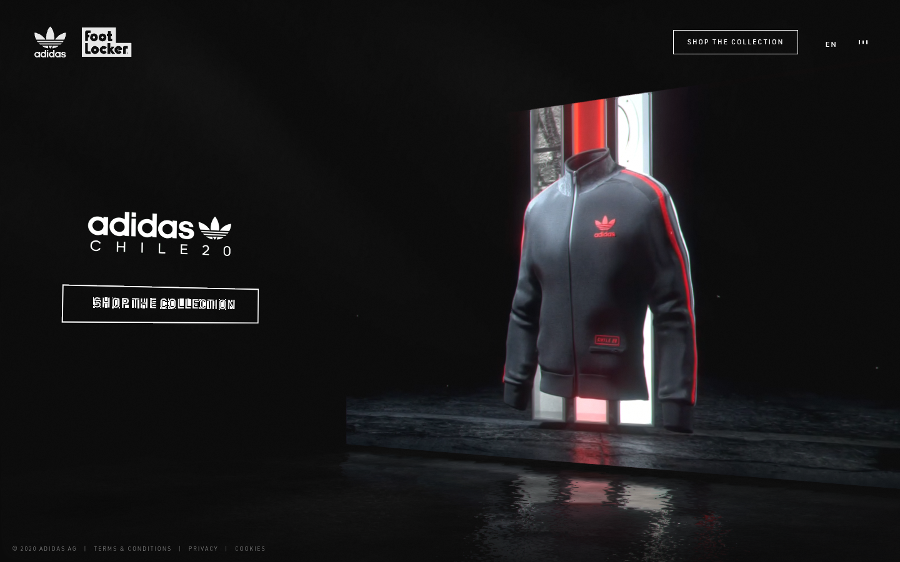
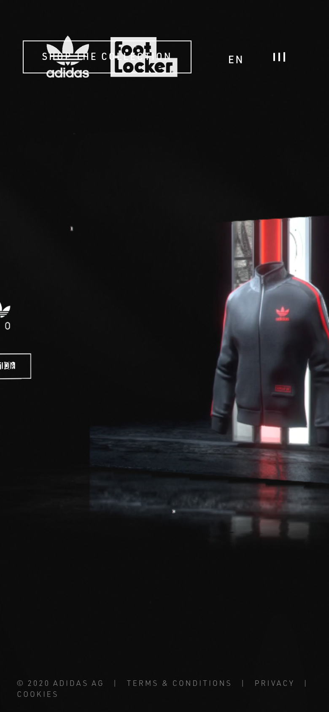
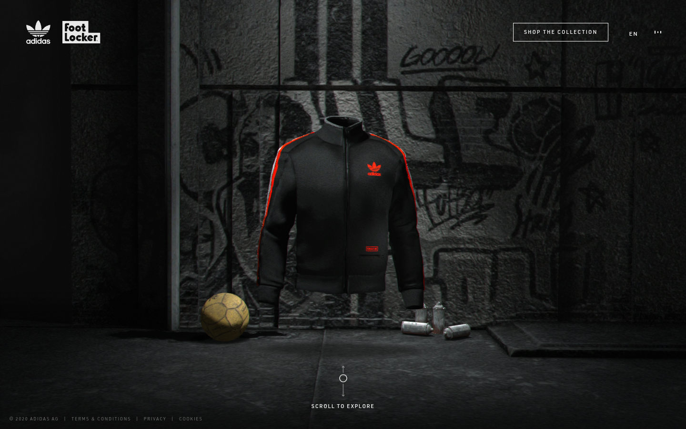
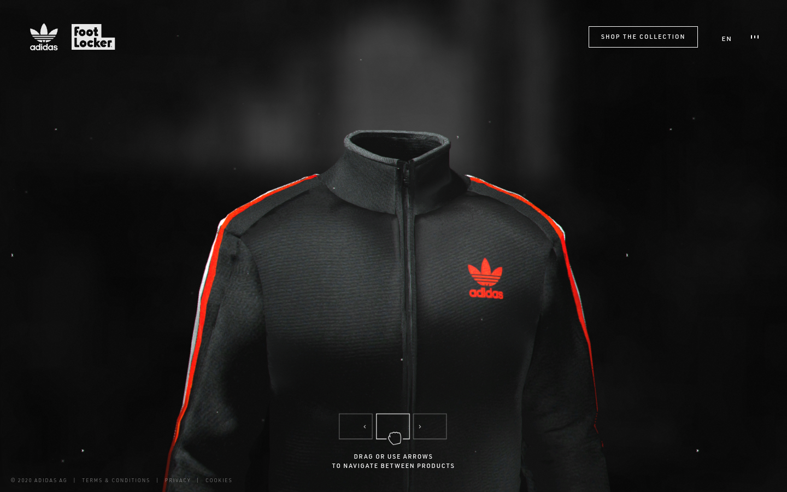
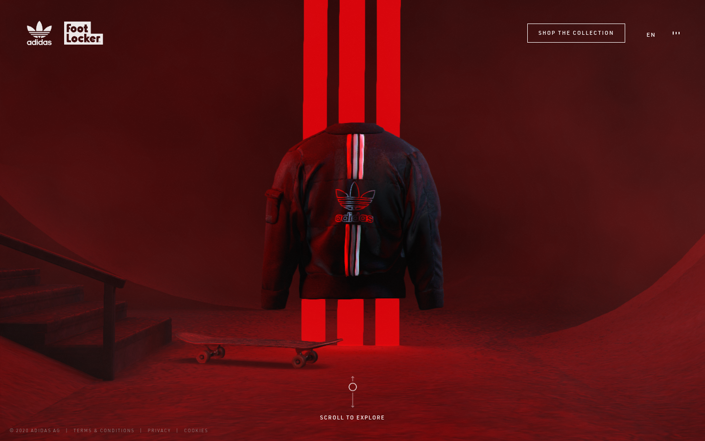
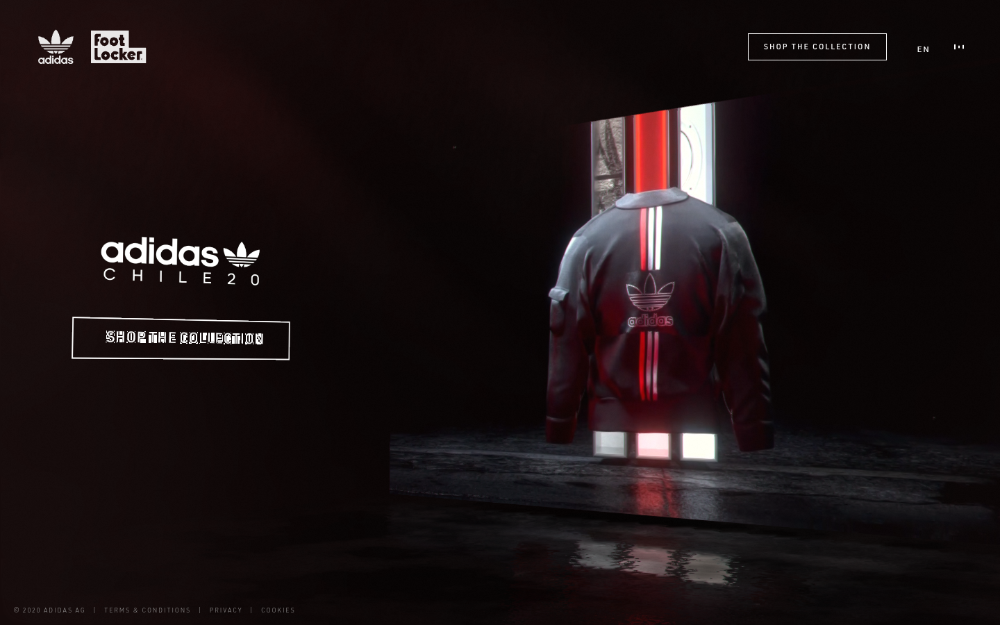
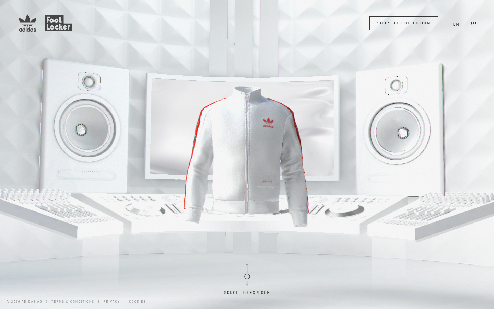
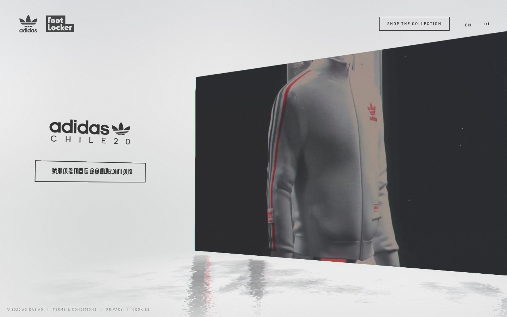

# adidas CHILE20 – `/black-tracksuit/3` ("Black Tracksuit Video") – Design & Technical Analysis

> Source: `https://adidaschile20.com/black-tracksuit/3`
> Analysed: 2026-11-15, from the served HTML, `assets/js/app.js` (945 KB), `assets/data/uil.json` (gzipped layout/shader config) and `assets/shaders/compiled.vs`.
>
> **Method.** The page is a 100 % WebGL canvas, so there is no DOM to inspect. I read the code/config **and** rendered the live page in headless Chrome (software WebGL) at 1440x900 and 390x844. Screenshots are in `chile20-screenshots/` and described in §0.
> Where §0 (observed) and later sections (inferred from code) disagree, **§0 wins**.

---

## 0. What it actually looks like (observed in screenshots)

### Desktop 1440x900 (`chile20-screenshots/desktop-1440x900.png`)



```
┌──────────────────────────────────────────────────────────────────────────────┐
│ [adidas trefoil] [Foot Locker]                  [SHOP THE COLLECTION] EN  ≡ │  header, ~y 65
│                                                                              │
│                                                     ╱‾‾‾‾‾‾‾‾‾‾‾‾‾‾‾╲       │
│                                                    │  red/white neon  │      │
│        adidas ⚘                                    │  light bars      │      │
│        C H I L E 2 0                               │   + black track  │      │
│                                                    │   top w/ red    │      │
│     ┌────────────────────────┐                     │   stripes       │      │
│     │ SHOP THE COLLECTION    │  (glitchy text)     ╲___glossy wet____╱      │
│     └────────────────────────┘                       floor + reflection     │
│ © 2020 ADIDAS AG | TERMS & CONDITIONS | PRIVACY | COOKIES                    │  footer
└──────────────────────────────────────────────────────────────────────────────┘
```

Observed details that the code alone did not make obvious:

1. **Header bar** (not mentioned earlier): adidas trefoil + Foot Locker logo top-left (~x 55-210); a **second, smaller "SHOP THE COLLECTION"** outlined button top-right (~x 1077-1277, y 48-87, 1 px white border, square corners, tracked caps ~11 px); `EN` language switch and a 3-bar menu icon at far right.
2. **The CTA is a square-cornered outlined rectangle, not a rounded pill.** The in-scene big one is slightly rotated (matches the +30° Y rotation) and its label has a **glitch / scanline flicker** while idle.
3. **Logo lockup**: stacked "adidas ⚘" wordmark over widely letter-spaced "C H I L E 2 0" (the `2 0` is lighter weight and spaced tighter than `CHILE`).
4. **The "video" is a screen floating in a black room.** It is a perspective-skewed quad on the right. Content: a black adidas track top with red side stripes and red trefoil, lit by a vertical red/white neon strip behind it, slight grain/dust.
5. **Floor** is dark wet asphalt/concrete with a distorted, rippling red reflection of the neon, plus a faint fog that fades the left edge to pure black.
6. **Particles**: tiny white specks float in the dark (visible in the second capture); subtle depth cue.
7. **Footer** (bottom-left): `© 2020 ADIDAS AG | TERMS & CONDITIONS | PRIVACY | COOKIES`, ~10 px, wide tracking, grey, hover underline.
8. **Overall palette on screen**: black `#0a0a0a`-ish, white UI, a single hot red accent (#ff2a2a-ish) coming only from the video content.

### Cookie bar (`desktop-with-cookiebar.png`)

Full-width black bar pinned to the top (~89 px tall): 11-12 px body text on the left, a 1 px outlined **ENABLE MARKETING COOKIES** button on the right (square corners, bold tracked caps). It overlaps the header until dismissed. There is no "decline" button; the bar's copy says only marketing cookies are opt-in.

### Mobile 390x844 @2x (`chile20-screenshots/mobile-390x844.png`)



- Header: logos top-left, `EN` and menu icon top-right; the **"SHOP THE COLLECTION" button overlaps the logos** in my capture, and the in-scene logo/CTA group sits off-screen on the left edge.
- The video screen is cropped on the right edge, the jacket is partly cut off.
- **Caveat:** this was captured in headless Chrome with touch emulation and software WebGL, 24 s after load, so it may be a mid-transition frame or an emulation artifact rather than the real mobile layout. Treat the overlaps as "worth checking on a real phone", not as confirmed bugs.
- With the cookie bar open (`mobile-with-cookiebar.png`) the bar's text wraps one word per line in a narrow left column and swamps the screen. That one looks like a genuine layout flaw (the cookie text container does not take the full width on narrow viewports), though it's also seen only in emulation.

### Corrections to earlier sections

| Earlier claim | Reality |
|---|---|
| CTA is a rounded **pill** | Outlined **rectangle**, square corners, glitch-flicker label |
| Only one CTA | Two: in-scene (left) + header (top-right) |
| Video filename unknown | **`assets/videos/world1.mp4`** (served with HTTP 206 range requests); `world2.mp4`, `world3.mp4` also preloaded |
| No header/footer described | Header with adidas + Foot Locker + EN + menu; footer legal links |
| Video content unknown | Black track top with red stripes lit by red/white neon, wet reflective floor |

---

## 0b. The other routes (observed, 1440x900)

Same shell, same header/footer, different "world". The video section (`/3`) of each world reuses the same layout (logo + CTA left, angled video screen right); only the video content and palette change.

| Route | Screenshot | What you see |
|---|---|---|
| `/black-tracksuit/1` (Landing) |  | Black track top floating in a dark graffiti alley: concrete wall with "GOOOOL!" tags, a worn leather football bottom-left, spray cans bottom-right. Bottom-centre hint: scroll icon + `SCROLL TO EXPLORE`. |
| `/black-tracksuit/2` (Closeup) |  | Extreme close-up of the jacket (collar, red stripe, red trefoil) on a blurred black background with dust specks. Bottom-centre: three-tile product switcher with a drag-hand cursor and `DRAG OR USE ARROWS TO NAVIGATE BETWEEN PRODUCTS`. The three feature captions from the copy file did not appear in my frame (likely timed). |
| `/bomber-jacket` landing (`bomber/1`) |  | Monochrome **red** skatepark: bomber seen from the back between three huge red vertical bars (adidas stripes), skateboard and stairs, curved bowl walls. Header logos tinted pale. |
| `bomber/3` (Video) |  | Same angled-screen layout as black `/3`, but the screen shows the bomber back with red/white neon bars. |
| `/white-tracksuit/1` (Landing) |  | All-white **recording studio**: white jacket in front of a monitor, flanked by two speakers, mixing desks below, quilted pyramid wall. Header logos and text switch to dark grey. |
| `/white-tracksuit/3` (Video) |  | Light grey room, dark text/logo (`W3_COLOR #353535`), same angled screen showing the white jacket on a dark background, wet reflective white floor. |

Takeaways: each world has its own colour identity (black/grey alley, red skatepark, white studio) and props that tell a story (football and spray cans = street, skateboard = skate, speakers = music). UI colour inverts automatically on the white world.

---

## 1. What this page is

| Item | Value |
|---|---|
| Campaign | **CHILE20**, adidas Originals x Foot Locker, September/October 2020 |
| Page title | `adidas – CHILE20` |
| Description | "CHILE20, Foot Locker and adidas Originals' latest collection breaks new grounds." |
| Built by | **Active Theory** (header of `app.js`: `https://activetheory.net`, build `10/7/20 12:17p`), on their in-house **Hydra** framework on top of three.js-style WebGL |
| Purpose | Immersive product microsite. Every "buy" action goes out to Foot Locker (`footlocker.co.uk/de/fr/it`) with UTM `adidaschileminisite / referral / adidaschile092020` |
| Languages | `en`, `de`, `fr`, `it` (copy is inlined in the HTML as JSON, `window._LANGUAGE_ = 'en'`) |

### The route `/black-tracksuit/3`

The router maps three "sections" for each of three "worlds":

```js
TRACKING_TITLES = {
  "black-tracksuit/1": "Black Tracksuit Landing",
  "black-tracksuit/2": "Black Tracksuit Closeup",
  "black-tracksuit/3": "Black Tracksuit Video",     // <-- this page
  "white-tracksuit/1": "White Tracksuit Landing",
  "white-tracksuit/2": "White Tracksuit Closeup",
  "white-tracksuit/3": "White Tracksuit Video",
  "bomber/1": "Bomber Landing", "bomber/2": "Bomber Closeup", "bomber/3": "Bomber Video"
}
// perma -> world
"black-tracksuit": "world1"   // dark / black world
"white-tracksuit": "world3"   // light / white world
// bomber            -> world2 (red-ish world)
```

So **`/3` is not a separate HTML page**. The server returns the same `index.html` shell for every route, and the JS app reads the URL and scrolls/cuts the camera to the third section of World 1: the **video section**.

---

## 2. Experience structure

```
ExperienceController
 ├─ World 1  "black-tracksuit"   (dark, #0c0c0c / #181818)
 │    ├─ Section 1  Landing   (hero, product, logo)
 │    ├─ Section 2  Closeup   (3 feature captions around the garment)
 │    └─ Section 3  Video     <-- /black-tracksuit/3
 ├─ World 2  "bomber"            (dark red tones, e.g. #8d4c4c crease, #060202 bg)
 └─ World 3  "white-tracksuit"   (light, #ededed bg, W3_COLOR #353535, accent #F2717E)
```

Global overlays and UI: `LoaderView` ("presents"), `Instructions`, `SoundIcon`, `MobileMenu`, `CookiesBar`, `ShareOverlay` / `ShareCard`, `PrizeOverlay` (the prize contest), `ExperienceWorldChange` (the transition between worlds).

Instruction strings shown to the user (EN):

```
SCROLL TO EXPLORE
SELECT A PRODUCT TO BEGIN
CLICK TO ENABLE SOUND
DRAG OR USE ARROWS TO NAVIGATE BETWEEN PRODUCTS
CLICK AND DRAG TO INTERACT
CLICK OUTSIDE TO CLOSE
```

Menu items: `Home`, `Black Tracksuit`, `Bomber Jacket`, `White Tracksuit`. Language switcher: German / English / French / Italian.

---

## 3. HTML shell (what the browser actually receives)

The whole `<body>` is empty. The app creates `#Stage` and the WebGL canvas at runtime.

```html
<!DOCTYPE html>
<html lang="en">
<head>
  <meta charset="utf-8">
  <meta name="viewport" content="width=device-width, initial-scale=1.0, maximum-scale=1.0,
        user-scalable=no, minimal-ui, viewport-fit=cover">
  <meta name="google" content="notranslate">
  <base href="/">                                   <!-- every route resolves assets from / -->
  <title>adidas – CHILE20</title>
  <meta name="theme-color" content="#ffffff">
  <link rel="mask-icon" href="assets/meta/safari-pinned-tab.svg" color="#ff1313">

  <!-- inline CSS: fonts + stage reset (see §4) -->
  <style>…</style>

  <!-- copy for all 4 languages, in-page -->
  <script type="text/json" id="_CACHE_">1602098237455</script>
  <script type="text/json" id="_DATA_">{"de":{…},"en":{…},"fr":{…},"it":{…}}</script>
  <script type="text/json" id="_LANGUAGES_">…</script>

  <script>
    // bootstrap: parse the JSON blobs, pick ES5 or modern bundle, load it async
    for (var _scr_ = ["_CACHE_","_DATA_","_LANGUAGES_"], i = 0; i < _scr_.length; i++) {
      window[_scr_[i]] = JSON.parse(document.getElementById(_scr_[i]).text);
    }
    window._LANGUAGE_ = 'en';
    let p = 'app';
    try { eval('async () => {};'); } catch (e) { window._ES5_ = true; p = 'es5-' + p; }
    const s = document.createElement('script');
    s.src = 'assets/js/' + p + '.js?' + window._CACHE_;   // app.js or es5-app.js
    s.async = true;
    document.head.appendChild(s);
  </script>
  <!-- Sentry 5.20, GA (UA-176756424-2, anonymize_ip, DNT-aware), Facebook Pixel (consent revoked by default) -->
</head>
<body></body>
</html>
```

Takeaways:
- Zero content in the HTML means **no SEO from the DOM**. The app compensates with a `GLSEO` layer that creates hidden accessible links for GL buttons, and with `og:` / `twitter:` meta.
- Respects **Do Not Track** (GA and FB only initialise if DNT is off), and cookies are opt-in for marketing.
- `maximum-scale=1, user-scalable=no`: pinch-zoom is disabled on purpose (it would fight the drag interaction).

---

## 4. Typography & base CSS

Three families ship as `woff2` + `woff` (and as `.json` + `.png` **MSDF font atlases** for in-WebGL text):

| Family | Weights / files | Used for |
|---|---|---|
| **URW DIN** | Thin, Light (400), Medium (500), Demi | Body, UI, captions |
| **adineue PRO** | Regular | adidas brand voice, headlines |
| fallback | `helvetica, arial, sans-serif` | |

Inline CSS actually present in the page (verbatim intent):

```css
@font-face { font-family:'URW DIN'; font-weight:500; font-style:normal;
  src:url('/assets/fonts/URWDIN-Medium.woff2') format('woff2'),
      url('/assets/fonts/URWDIN-Medium.woff')  format('woff'); }
@font-face { font-family:'URW DIN'; font-weight:400; font-style:normal;
  src:url('/assets/fonts/URWDIN-Light.woff2')  format('woff2'),
      url('/assets/fonts/URWDIN-Light.woff')   format('woff'); }
@font-face { font-family:'adineue PRO'; font-weight:normal; font-style:normal;
  src:url('/assets/fonts/adineuePRO-Regular.woff2') format('woff2'),
      url('/assets/fonts/adineuePRO-Regular.woff')  format('woff'); }

body { font-family:'URW DIN','helvetica','arial','sans-serif'; }

body, html, #Stage {
  margin:0; padding:0; width:100%; height:100%;
  overflow:hidden; background:#000;
  touch-action:none;              /* the app owns all gestures */
}
#Stage, #Stage * {                /* Hydra positions everything absolutely */
  position:absolute; user-select:none; -webkit-tap-highlight-color:rgba(0,0,0,0);
}
#Stage br, #Stage span { position:relative; }

/* thin, translucent custom scrollbar */
body ::-webkit-scrollbar          { width:12px; }
body ::-webkit-scrollbar-thumb    { background-color:rgba(255,255,255,.2); }
body.world3 ::-webkit-scrollbar-thumb { background-color:rgba(0,0,0,.1); }  /* flips on the light world */

.footer-terms:hover, .footer-privacy:hover, .footer-cookies:hover { text-decoration:underline !important; }
```

---

## 5. Colour system

Frequency of hex values in the bundle, plus the values found in the World 1 video-section config:

| Role | Hex | Notes |
|---|---|---|
| Pure white | `#ffffff` | Most used value (~70 hits): text, buttons, logo tint in worlds 1 and 2 |
| Pure black | `#000000` | Stage background, button hover text, floor tint |
| Brand blue accent | `#37a1ef` | ~20 hits, interactive/highlight accent |
| Dark UI grey | `#2e2e2e`, `#161616`, `#1d1d1d`, `#272727` | Panels, overlays |
| Mid greys | `#545454`, `#444444`, `#9B9C9B`, `#AAAAAA` | Secondary text, placeholder video colour (`VideoShader.uColor = #444444`) |
| adidas red | `#FF1313` | Safari pinned-tab mask colour |
| World 3 text colour | `#353535` | `Global.W3_COLOR` (logo and button on light world) |
| World 3 accent | `#F2717E` | `Global.W3_COLOR2` (pink) |
| **World 1 video section** | | |
| Back wall / FixedBackground | `#0c0c0c` | near-black |
| Bg1 plane | `#181818` | slightly lifted black |
| Crease (fold overlay) | `#595959` @ alpha 0.3 | faint fabric-fold texture |
| Floor base colour | `#000000` | glossy PBR floor, see §7 |

Suggested CSS tokens if you want to reuse the palette:

```css
:root {
  --c-black:      #000000;
  --c-bg-deep:    #0c0c0c;   /* world1 video background */
  --c-bg:         #181818;
  --c-panel:      #2e2e2e;
  --c-grey:       #9b9c9b;
  --c-white:      #ffffff;
  --c-accent:     #37a1ef;
  --c-w3-ink:     #353535;
  --c-w3-accent:  #f2717e;
  --c-adidas-red: #ff1313;
}
```

---

## 6. What you see on `/3` (reconstructed from the code)

Layout, all in 3D space (`VideoUI`, `Video3DUI`, `VideoPlane`):

```
                     Camera  z=6.5, lerp 0.07, mouse parallax moveXY [0.8, 0.4]
 ┌────────────────────────────────────────────────────────────────────────┐
 │  near-black room (#0c0c0c), glossy black PBR floor with soft reflection │
 │                                                                        │
 │   [ CHILE20 logo ]            ┌───────────────────────┐                 │
 │   (chille.png, white)         │   VIDEO PLANE 16:9     │  rotated -35°  │
 │                               │   scale [4, 2.25, 1]   │  on Y axis     │
 │   [ SHOP THE COLLECTION ]     │   pos  [0.865, 0, 0]   │  (angled to    │
 │   (pill button, GL-rendered)  └───────────────────────┘   the viewer)   │
 │                                                                        │
 │        glossy floor reflects video (VideoMirror / FX.Mirror)           │
 └────────────────────────────────────────────────────────────────────────┘
```

Key facts:

- **Desktop**: the logo + "SHOP THE COLLECTION" button group sits on the **left** (`x = -1.8, y = -0.15`) and is rotated `+30°` (0.5236 rad) on Y, so it faces the angled video on the right.
- **Mobile**: group moves to `x = 0.7`, `y = 1.8` (tablet 1.5), scale `1.3` (tablet 1), no Y rotation, and the camera is pushed back (`z = 12` for element 1; `5.5` for element 2, `fov = 50`).
- **Responsive camera** driven by aspect ratio:
  ```js
  camera.groupPos.z = Math.range(aspect, 1.1, 1.6, 5, 0, true); // wider screen -> closer
  camera.fov        = Math.range(aspect, 2.2, 2.8, 30, 20, true);
  ```
- **Video plane scene objects** (World 1, from `uil.json`):

  | Layer | Position | Rotation | Scale |
  |---|---|---|---|
  | Element 0 (video screen) | `[0.865, 0, 0]` | `[0, -35, 0]` | `[4, 2.25, 1]` |
  | Element 1 (floor) | `[0, -1.15, 1.75]` | `[-90, 0, 90]` | `[10, 10, 1]` |
  | Element 3 (crease/fabric overlay) | `[-0.923, 0.657, 0]` | `[0, 0, -12.88]` | `[6, 3.5, 1]` |
  | Element 7 (area light) | `[0.85, 0, 0]` | – | – |

- **Area light** aimed at the screen: `width 4.05, height 2.4, distance 3.225, intensity 0.68, roughness 0.5, color #fff`.

---

## 7. Rendering techniques

### 7.1 Floor: PBR with reflection and fog

```js
// uil.json  (World 1, video section, Element_1)
uColor:        #000000
uReflect:      1.1            // strong mirror contribution
uRough:        [0, 1.232]
uMRO:          [0, 0.7, 0]    // metal / roughness / occlusion
uNormalScale:  [3, 1]
uFogPosition:  [0.056, 0, 0.877]
uFogRange:     [1.2, 3.2]     // floor fades into the dark room
uLight:        [1, 1, 1, 0]
// textures
tBaseColor   assets/images/floor/low/floor_intro_BaseColor_low.png
tNormal      assets/images/floor/low/floor_intro3d_Normal_low.png
tMRO         assets/images/floor/low/floor_DefaultMaterial_MRO_low.png
tEnvDiffuse  assets/images/env-diffuse-sRGB.png
tEnvSpecular assets/images/env-specular-sRGB.png
```

The `VideoMirror` component builds a planar reflection (`FX.Mirror`) of every mesh in the layout, at a resolution chosen by a device test (`Tests.videoMirrorResolution()`). That is why the video "glows" onto the floor.

### 7.2 Video as a texture

```js
// VideoPlane (simplified from the minified source)
_videoTexture = initClass(VideoTexture, `assets/videos/${_perma}.mp4`,
                          { loop: true, muted: false, autoplay: false });
_shader.uniforms.tMap.value = _videoTexture.texture;

function loop() {
  if (_section && Global.CLICKED) {                  // audio gate: user must click first
    const p = _section.transitionProgress;
    _interact3D.enabled = p > -0.7 && p < 0.6;
    (_videoTexture.active && (p < -0.8 || p > 0.8)) ? pause() : play();
  }
}
function play()  { /* start() + tween uPlay -> 1 over 300ms (easeOutSine) */ }
function pause() { /* stop(), video.pause(), tween uPlay -> 0 */ }
```

Behaviour you can lift:
- Video plays **only while this section is the active one** (transition progress inside ±0.8) and pauses itself when you scroll away or change world (`ExperienceController.SCENE_CHANGED`).
- It starts **unmuted** but only after the first click (`Global.CLICKED`), which is also why the UI says "CLICK TO ENABLE SOUND".
- Before playing, `tPreview` shows a poster: `assets/images/videos/world1.jpg`.

### 7.3 VideoShader uniforms

```js
{
  transparent: true,
  tPreview:   null,           // poster image
  tMap:       null,           // live video texture
  uColor:     '#444444',      // tint while idle
  uBrightness: 0,
  uPlay:      0,              // 0 = idle/poster, 1 = playing (cross-fade)
  uAlpha:     1
}
```

### 7.4 GL-native UI

Buttons, logo and text are **meshes inside the scene**, not DOM:

```js
// the CTA on the video section
Button({ text: "menu.buy_cta",     // -> "SHOP THE COLLECTION"
         group: "video", is3D: true,
         camera: section.camera,
         color: world3 ? "#353535" : "#ffffff",
         ariaLabel: copy("menu.buy_cta") })
  .onClick = () => {
     const link = copy(`closeup.${perma}_buynow_link`);   // footlocker.* URL
     Track.event("worlds", "click", "shop-the-collection", perma);
     Tests.socialBrowser() ? window.open(link) : window.open(link, "_blank").focus();
  };
```

Button visual spec (from `Button` class):
- Size: 200 x 50 (2D) or ~1.2 x 0.225 world units (3D), 1.8 scale on mobile. A rounded pill drawn by a shader (`uRatio = w/h`).
- Idle: white pill, white text. **Hover**: `uHover` 0 -> 1 over **500 ms easeOutQuart** (pill fills), label colour tweens to black, group pops forward `z: 0 -> 0.1`. Out: **800 ms** easeOutQuart.
- Text size: `Math.range(Stage.width, 600, 1500, 11, 14)` px on desktop (11 -> 14 px).
- Accessibility: `GLSEO.link(...)` plus `ariaLabel` expose it to crawlers and screen readers.

Logo: `assets/images/logos/chille.png` (aspect `1 : 0.358`), driven by a `VideoLogo` shader with `uCut` (transition mask), `uAlpha`, `uColor`.

The UI fades to `alpha 0.2` (800 ms easeOutCubic) whenever a world change, the "stripes" transition or an overlay is open, so it never fights the transitions.

### 7.5 Transitions

Textures in `assets/images/transitions/`: `clouds.jpg`, `crease.jpg`, `lines.png`, `noise.png`, `screenlines.png`, `steam.png`. These are used as masks by the `uCut` / `transitionUniform` shader inputs for the wipe between sections and worlds.

### 7.6 Camera

```
fov           30 (desktop) → 20 on ultra-wide, 50 on mobile
position      [0, 0, 6.5]
lerpSpeed     0.07            // smooth follow
moveXY        [0.8, 0.4]      // mouse parallax range
wobble / deltaRotate           // subtle idle drift
```

---

## 8. Copy used around this section

```
menu.buy_cta                 SHOP THE COLLECTION
closeup.world1_closeup_1     Born from the streets
closeup.world1_closeup_2     Weather-resistant wet look fabric keeps you moving
closeup.world1_closeup_3     Soft-brushed lining keeps you warm at night
closeup.world1_buynow_link   https://www.footlocker.co.uk/en/all/adidas_chile-20?utm_source=adidaschileminisite&utm_medium=referral&utm_campaign=adidaschile092020
```

Product menu (EN) → Foot Locker product IDs: Black Track Top `84776`, Black Track Pants `84777`, White Track Top (`84776`, other variant), White Track Pants (`84777`), Bomber Jacket `94542`, Black Hoodie `84778`, Black T-shirt `84781`, Red Crew Neck `84779`.

Contest layer (inactive on most languages): find hidden elements per world (Ball / Skateboard / Orb) to win a JBL Charge 4 speaker; posts to `api.promoveritasdata.it/v3.5/newentry`. Share feature renders custom cards from Figma-exported JSON (`assets/data/figma/share-card-*.json`) in square and portrait formats.

---

## 9. Asset inventory (confirmed paths)

```
assets/js/app.js | es5-app.js                        engine + app, ~945 KB minified
assets/shaders/compiled.vs                           all GLSL, concatenated (~187 KB, 6.6k lines)
assets/data/uil.json                                 gzipped scene/shader config (Active Theory "UIL")
assets/data/figma/*.json                             share-card layouts
assets/fonts/URWDIN-{Thin,Light,Medium,Demi}.{woff,woff2,json,png}
assets/fonts/adineuePRO-Regular.{woff,woff2,json,png}
assets/images/logos/{chille.png,chile-logo.png,chile.svg,logo.svg,arrow.png}
assets/images/icons/{arrow.png,cross.svg,phone.svg}
assets/images/transitions/{clouds,crease}.jpg, {lines,noise,screenlines,steam}.png
assets/images/pbr/lut.png, env-diffuse-sRGB.png, env-specular-sRGB.png
assets/images/floor/low/floor_*.png
assets/images/videos/world1.jpg                      video poster (World 1)
assets/images/_lighting/arealights.json
assets/images/sprites/logo/{in,out}.{json,png}       logo reveal sprite sheets
assets/_sounds/main-optimized.mp3                    ambient soundtrack
assets/videos/<perma>.mp4                            ← the video for this section
```

**Video URL (confirmed in the Network log):** `assets/videos/world1.mp4`. The code builds it from the world id (`world1`/`world2`/`world3`), not the route slug, which is why my first guess `black-tracksuit.mp4` was a 404. The browser also preloads `world2.mp4`, `world3.mp4` and `assets/_sounds/main-optimized.mp3`.

---

## 10. Tech stack summary

| Layer | Choice |
|---|---|
| Rendering | WebGL via Hydra (Active Theory) with a three.js-compatible API (`Mesh`, `Group`, `Color`, `Vector3`, `ShaderMaterial`-like `Shader`) |
| UI | **GLUI** (UI as GL meshes) + MSDF text; small DOM layer for cookies bar, mobile menu, overlays |
| Interaction | `Interaction3D` raycasting, mouse parallax, drag, arrow keys, scroll |
| Audio | `AudioController`, `SoundIcon`, one looped MP3 + per-video audio |
| Routing | History-based, `<base href="/">`, server returns the same shell for every path |
| Analytics | GA (`UA-176756424-2`), Facebook Pixel, DoubleClick Floodlight noscript, Sentry 5.20; all honour DNT/consent |
| Compat | Separate ES5 bundle when `async` arrow functions are unsupported; `old_browser` message; portrait-lock message on rotate |
| Perf | Device tests choose mirror resolution; low-res floor textures (`floor/low`); `requestIdleCallback` polyfill; video paused off-screen |

---

## 11. Minimal re-creation sketch (my own approximation, **not** the site's code)

If you want the same *look* with standard tools: dark room, angled video, glossy reflective floor, left-side logo + pill CTA, mouse parallax. This is plain three.js (r160-style API).

```html
<!doctype html>
<meta name="viewport" content="width=device-width, initial-scale=1">
<style>
  html, body { margin:0; height:100%; background:#0c0c0c; overflow:hidden; font-family:'URW DIN',Helvetica,Arial,sans-serif; }
  #cta { position:fixed; left:8vw; top:55%; padding:14px 34px; border:1px solid #fff; border-radius:999px;
         color:#fff; text-decoration:none; letter-spacing:.12em; font-size:clamp(11px,.9vw,14px);
         transition:background .5s cubic-bezier(.165,.84,.44,1), color .5s cubic-bezier(.165,.84,.44,1); }
  #cta:hover { background:#fff; color:#000; transform:translateZ(0); }
  #logo { position:fixed; left:8vw; top:38%; width:min(30vw,300px); }
</style>

<a id="cta" href="https://www.footlocker.co.uk/en/all/adidas_chile-20" target="_blank" rel="noopener">SHOP THE COLLECTION</a>
<video id="v" src="video.mp4" loop playsinline preload="auto" crossorigin="anonymous" style="display:none"></video>

<script type="module">
import * as THREE from 'https://unpkg.com/three@0.160.0/build/three.module.js';
import { Reflector } from 'https://unpkg.com/three@0.160.0/examples/jsm/objects/Reflector.js';

const renderer = new THREE.WebGLRenderer({ antialias:true });
renderer.setPixelRatio(Math.min(devicePixelRatio, 2));
renderer.setSize(innerWidth, innerHeight);
document.body.prepend(renderer.domElement);

const scene = new THREE.Scene();
scene.background = new THREE.Color('#0c0c0c');
scene.fog = new THREE.Fog('#0c0c0c', 4.2, 9);               // like uFogRange [1.2, 3.2]

const camera = new THREE.PerspectiveCamera(30, innerWidth/innerHeight, 0.1, 50);
camera.position.set(0, 0, 6.5);                              // site: [0,0,6.5]

// video screen: 4 x 2.25, at [0.865,0,0], rotated -35° on Y (site values)
const video = document.getElementById('v');
const tex = new THREE.VideoTexture(video); tex.colorSpace = THREE.SRGBColorSpace;
const screen = new THREE.Mesh(new THREE.PlaneGeometry(4, 2.25),
                              new THREE.MeshBasicMaterial({ map: tex }));
screen.position.set(0.865, 0, 0);
screen.rotation.y = THREE.MathUtils.degToRad(-35);
scene.add(screen);

// glossy floor at y=-1.15, 10x10 (site values), reflecting the screen
const floor = new Reflector(new THREE.PlaneGeometry(10, 10), {
  textureWidth: innerWidth/2, textureHeight: innerHeight/2, color: 0x202020 });
floor.rotation.x = -Math.PI/2; floor.position.set(0, -1.15, 1.75);
scene.add(floor);

// play only after a user gesture (audio policy), mirror the site's behaviour
addEventListener('pointerdown', () => video.play(), { once:true });

// mouse parallax: moveXY [0.8, 0.4], lerp 0.07
const target = new THREE.Vector2();
addEventListener('pointermove', e => {
  target.set((e.clientX/innerWidth - .5) * 0.8, -(e.clientY/innerHeight - .5) * 0.4);
});

// aspect-driven FOV, same idea as Math.range(aspect, 2.2, 2.8, 30, 20)
const range = (v,a,b,c,d) => c + (d-c) * Math.min(1, Math.max(0, (v-a)/(b-a)));
function resize() {
  camera.aspect = innerWidth/innerHeight;
  camera.fov = range(camera.aspect, 2.2, 2.8, 30, 20);
  camera.updateProjectionMatrix();
  renderer.setSize(innerWidth, innerHeight);
}
addEventListener('resize', resize); resize();

renderer.setAnimationLoop(() => {
  camera.position.x += (target.x - camera.position.x) * 0.07;
  camera.position.y += (target.y - camera.position.y) * 0.07;
  camera.lookAt(0, 0, 0);
  renderer.render(scene, camera);
});
</script>
```

What this sketch deliberately omits: PBR floor textures and env maps, MSDF text, the section/world transitions, GL-rendered buttons, the crease overlay, sound, contest/share overlays.

---

## 12. Design principles worth copying

1. **One idea per section**: landing → closeup → video; each is a camera move, not a page load.
2. **Near-black, low-chroma palette** so the product and video are the only bright things.
3. **Reflection + fog** make a flat video feel like an object in a room.
4. **Parallax + damped camera** (`lerp 0.07`) gives weight without motion sickness.
5. **Audio only after a click**, always explained by the on-screen hint.
6. **UI fades to 20 % during transitions** so chrome never competes with motion.
7. **Slow-in easing everywhere** (`easeOutQuart`/`easeOutCubic`, 500 to 800 ms).
8. **Single conversion path**: one pill CTA per section, tracked and UTM-tagged.
9. **Costs to know before copying**: ~1 MB of JS, no DOM content (weak SEO and a11y without an extra layer like `GLSEO`), heavy GPU use.

---

*Possible next steps:* capture the other sections (`/1`, `/2`) and worlds, record a short frame sequence of the glitch/transition effects, and test the mobile layout on a real device (my mobile capture was emulated).
