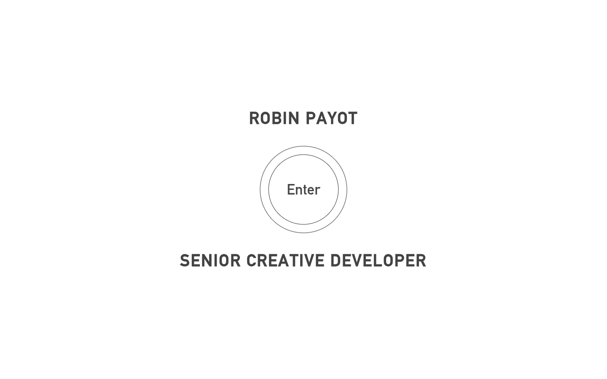
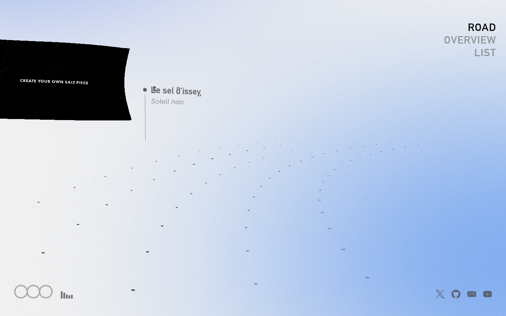
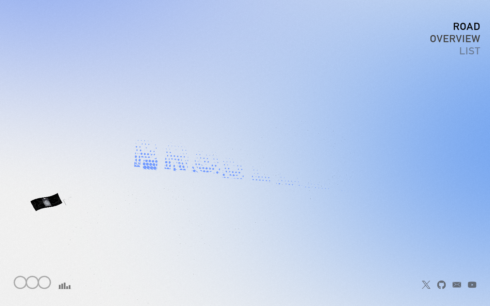
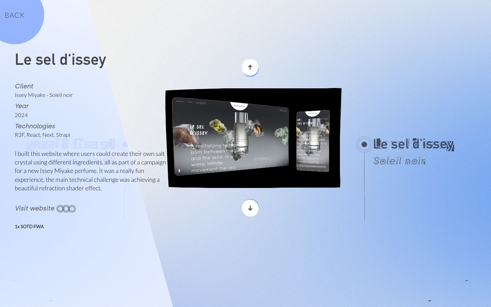

# robinpayot.com – Design & Technical Analysis

> Source: `https://robinpayot.com/` (analysed 2026-11-15)
> **Method:** read the served HTML, `main.fc8479f1eef2be9b39d9.css` (41 KB) and `bundle.fc8479f1eef2be9b39d9.js` (1.2 MB), **and** rendered the live site in headless Chrome (software WebGL, 1440x900). Screenshots are in `robinpayot-screenshots/`.
> **Limits:** the List and About views did not capture (my menu clicks missed, see §10). Mobile was not captured. Frame-timing/animation details are inferred from code, not recorded.

---

## 1. What it is

Portfolio of **Robin Payot, Senior Creative Developer (freelance, Paris)**. Title: `Robin Payot - Senior Creative Developer Freelance`. Pitch (meta): WebGL/JS 3D and 2D sites, first WebGL site 2015, HETIC degree 2016, agencies, then a metaverse project.

It is a single-page, full-viewport **WebGL experience**: the portfolio projects live in a 3D scene you travel through ("Road"), with alternate views (Overview, List, About) and a detail panel per project.

Contact/socials in the footer: X, GitHub, email, YouTube.

---

## 2. Experience flow

```
Intro (white screen)  ->  click "Enter"  ->  ROAD  (3D scene, scroll to move)
                                              |-- OVERVIEW  (projects shown as dotted/particle blocks)
                                              |-- LIST      (text list: title, subtitle, awards)
                                              |-- ABOUT
                                              '-- click a project -> PROJECT DETAIL panel
```

Menu (top-right, right-aligned stack): `ROAD`, `OVERVIEW`, `LIST`, `ABOUT`. The active item is black, the others grey.

---

## 3. Page shell (verbatim structure)

The HTML is tiny. Everything is mounted into data-attributes:

```html
<body class="no-scroll">
  <section class="fixed-container">
    <section class="scene" data-scene>
      <canvas class="scene__canvas" data-scene-canvas></canvas>
      <section class="scene__project project is-left" data-scene-project></section>
      <section class="scene__menu" data-scene-menu></section>
      <section class="scene__listview" data-scene-listview></section>
      <section class="scene__footer" data-scene-footer></section>
      <section class="scene__scroll-text t-scroll is-hidden" data-scroll-text>Scroll to explore</section>
      <section class="scene__overlay" data-scene-overlay></section>
    </section>
    <div class="touch-zone" data-touch-zone></div>
    <section class="rotate-device" data-rotate-device>
      <p class="rotate-device__p">Please rotate your device</p> ...
    </section>
    <section class="intro" data-intro>
      <h1 class="intro__text t-intro split-text" data-split-text>ROBIN PAYOT</h1>
      <div class="intro__logo"><svg viewBox="0 0 504 198"> ...6 looping wave paths... </svg></div>
      <h2 class="intro__text t-intro split-text" data-split-text>SENIOR CREATIVE DEVELOPER</h2>
      <div class="intro__button" data-intro-button>
        <svg viewBox="0 0 400 400"><circle r="107"/><circle r="86"/></svg>
        <button class="intro__button__text">Enter</button>
      </div>
    </section>
  </section>
  <script src="./bundle.fc8479f1eef2be9b39d9.js"></script>
</body>
```

Notes: `body.no-scroll {overflow:hidden}`; the page never scrolls natively, scroll input drives the 3D camera. A `rotate-device` overlay asks mobile users to rotate. `cookieconsent@3` (jsDelivr) shows the cookie bar; Google Analytics `G-98BKRPHR5E`.

---

## 4. Intro screen (observed, `01-intro-enter.png`)



- Pure **white** background, everything centred, all in dark grey `#434343`.
- `ROBIN PAYOT` (top) and `SENIOR CREATIVE DEVELOPER` (bottom), Roadgeek bold, ~42 px, letter-spacing `.06em`, split-text reveal.
- Centre: **two concentric 1 px circles** (r=107 and r=86 in a 400x400 viewBox, stroke `#434343` 1.3) with `Enter` inside (opacity .7). The label is `pointer-events:none`; the circles take the click. They animate on hover (`will-change: transform`).
- The logo SVG (six interlocking sine-wave paths forming an infinity/wave motif) is animated with the `loop-path-outer/middle/inner` keyframes. In my captures it was hidden by the time the Enter button showed.
- Cookie bar bottom: grey text + round dark "Got it!" button (cookieconsent default).

```css
.t-intro { font-family:Roadgeek; font-weight:700; font-size:42px; letter-spacing:.06em; line-height:1.2em; }
.intro__button__text { position:absolute; left:50%; top:50%; transform:translate(-50%,-50%);
  pointer-events:none; opacity:.7; color:#434343 !important; }
.intro__button__circle { stroke:#434343; stroke-width:1.3; will-change:transform; }
```

---

## 5. The Road view (observed, `02/03/04-road-*.png`)



- **Background:** a soft CSS/WebGL gradient from near-white (`#f0f0f0`-ish) at the left/top to a periwinkle blue (`#749cff` family) bleeding in from the right and bottom, with fine **film grain** over everything.
- **Ground:** a field of tiny dark dots/ellipses laid out in perspective, forming the "road" the camera moves along (dots shrink toward the horizon). When you scroll they re-arrange into curves/spirals (see `04-road-scrolled-2.png`).
- **Project markers:** a billboard card (black, curved like a flag) with a project label and the caption (e.g. "CREATE YOUR OWN SALT PIECE"), plus a pin: filled dot, thin vertical line, title `Le sel d'issey` (Roadgeek/Silka) and italic subtitle `Soleil noir`. Text appears with a glitch/scramble shader.
- After scrolling, projects collapse into small 3D objects at the far left (a gradient sheet with orange/pink/blue bands, a blue speckled capsule, a white sphere, a blue blob). I read these as simplified 3D previews of the projects, not confirmed.
- **HUD:**
  - top-right: menu stack (ROAD black, others grey `~#8a8a8a`, 28 px-ish, Roadgeek/DIN-like caps)
  - bottom-left: three linked outlined circles with a progress arc (scroll progress, `footer__indicator--progress` uses a stroke-dasharray `1352`) and a small bar/equaliser icon (sound toggle)
  - bottom-right: X, GitHub, mail, YouTube icons in grey.

---

## 6. Overview view (`05-overview.png`)



Camera swings up and the project titles render as **huge text made of halftone dots** (blue `#749cff`-ish, the text sits in perspective, receding to the right, dissolving into particles). One black curved card sits bottom-left. Menu now highlights `OVERVIEW`. CSS has `.t-title-overview` (Roadgeek, 5.6vw, opacity .75) and `.t-subtitle-overview` (Silka italic, 4.8vw) for these, but in WebGL they're drawn as point sprites.

---

## 7. Project detail (`06-project-detail.png`)



Opening a project (here **Le sel d'issey**) slides in a **left panel** over a diagonal translucent lavender shape while the 3D scene shifts right:

| Element | Detail |
|---|---|
| `BACK` | top-left in a large semi-transparent blue circle (`project__back-circle`, radius cut off by the viewport, opacity .7) |
| Title | `Le sel d'issey`, Roadgeek, ~50 px (`.t-h1`) |
| Meta | labels in Silka italic (`.t-h2`: Client, Year, Technologies), values in Lato light (`.t-text`) |
| Example | Client: Issey Miyake - Soleil noir; Year: 2024; Tech: R3F, React, Next, Strapi |
| Description | Lato light, ~16 px/1.4: "I built this website where users could create their own salt crystal using different ingredients ... achieving a beautiful refraction shader effect." |
| Link | `Visit website` (Silka italic) + the animated triple-circle glyph (`project__link__svg`) |
| Awards | `1x SOTD FWA` (small Lato) |
| Media | centre: video/mockup in a black frame, with up/down circular arrow buttons (white discs with blue progress ring) to step through the project's media |
| Right | the 3D marker again: dot with ripple rings, title with glitch effect, italic subtitle, vertical line |

Panel states in CSS: `project__outer`, `project__container {overflow:auto}`, `project__next/__back` CTAs, `is-left` modifier (panel can also sit on the right).

---

## 8. Design system

### Fonts (self-hosted `fonts/`, plus Google Fonts)

| Token | Font | Use |
|---|---|---|
| `t-h0` | IBM Plex Sans | 7.5vw uppercase display (max 144 px) |
| `t-h1` | **Roadgeek 2005 Mittelschrift** | titles, 2.6vw -> 50 px, 24 px on mobile |
| `t-h2`, `t-cta-small` | **Silka Regular Italic** | labels, 1.25vw -> 16/24 px |
| `t-h3`, `t-text` | **Lato** 300 | body, 1.25vw -> 16/24 px |
| `t-cta` | Lato 300 uppercase, `letter-spacing:.05em`, colour `#434343` | buttons |
| `t-title-sb` | Roadgeek, `.03em`, `scaleX(1.1)` | section titles |

Roadgeek (the road-sign typeface) is a deliberate nod to the "Road" metaphor. Glyph atlases (`IBMPlexSans-Bold-Atlas.png`, `Roadgeek-...-atlas.png`, `Silka-RegularItalic-atlas.png`, `Lato-Regular-atlas.png`) show text is also rendered **in WebGL via MSDF/bitmap atlases**.

### Colours (all hex values in the CSS)

```css
:root {
  --white:  #ffffff;   /* page / intro bg */
  --ink:    #434343;   /* intro text, CTA, circles */
  --black:  #000000;   /* body text, active menu */
  --blue:   #749cff;   /* gradient / halftone accent */
  --green:  #73cb62;   /* accent present in CSS */
  --peach:  #f5b59e;   /* accent present in CSS */
}
```
The scene itself is a light, airy palette: off-white to periwinkle gradient, black cards as the only high-contrast objects.

### Responsive type approach
Every style is `vw`-based with hard clamps via media queries (`<=1280px`, `>=1920px`, `<=900px`), e.g.:

```css
.t-h1 { font-family:Roadgeek; font-size:2.6041666667vw; line-height:1.2em; }
@media (max-width:1920px) { .t-h1 { font-size:50px; } }
@media (max-width:900px)  { .t-h1 { font-size:24px; } }
```

### CSS keyframes present
`loop-path-outer`, `loop-path-middle`, `loop-path-inner` (intro logo paths), `rotate-arrow`, `rotate-device`.

---

## 9. Tech stack (from the bundle)

| Area | Evidence in `bundle.js` |
|---|---|
| 3D | **three.js r1xx** (REVISION literal `16...`), `GLTFLoader` (26 hits), `DRACOLoader`, `InstancedMesh`, `Points` (125 hits), `ShaderMaterial` (45), `Raycaster`, `OrbitControls` (debug), `EffectComposer` (post-processing) |
| Animation | **GSAP** (31 hits, `TweenMax` legacy) |
| Audio | **Howler** (52 hits) and `Tone` (12) |
| Assets | `capsule.glb`, many project videos (`le-sel-d-issey-0.mp4`, `bmw-*.jpg`, `lvmh-the-showroom-*`, `affirm-*`, `kokopako-*`, `eaktr-*`, `forest-*`, `glowing-tree-*`, `codrops-*`, `howtocodethat-*`, `jigsaw-*`, `malt-academy-*`, `crumbskees-*`, `christmas-xp-*`, `cube-*`), fonts atlases |
| Build | webpack, content-hashed `bundle.<hash>.js` / `main.<hash>.css` |
| 3rd party | cookieconsent 3 (jsDelivr), Google Analytics, gtag |

Portfolio list (from asset names, i.e. likely projects): Le sel d'Issey, BMW, LVMH The Showroom, Affirm, Kokopako, EAKTR, Forest, Glowing Tree, Codrops, How To Code That, Jigsaw, Malt Academy, Crumbskees, Christmas XP, Cube.

---

## 10. Gaps / caveats

- **List and About views were not captured**: my coordinate clicks on those menu items didn't change the view. I haven't seen them.
- Mobile layout not captured (there is a "rotate device" gate, so mobile likely requires landscape).
- Descriptions of the small 3D objects in the scrolled Road view are my interpretation.
- Software WebGL, so frame rate, grain and shader timing may differ from a real GPU.

---

## 11. Minimal re-creation sketch (approximation, not the site's code)

Intro with concentric-circle Enter button, then a gradient background with a perspective dot field that responds to scroll. three.js.

```html
<!doctype html>
<meta name="viewport" content="width=device-width,initial-scale=1">
<style>
  html,body{margin:0;height:100%;overflow:hidden;font-family:Lato,sans-serif;color:#434343}
  #intro{position:fixed;inset:0;background:#fff;display:grid;place-content:center;gap:48px;text-align:center;z-index:10;transition:opacity .8s}
  #intro h1,#intro h2{font:700 42px/1.2 Roadgeek,'IBM Plex Sans',sans-serif;letter-spacing:.06em;margin:0}
  #enter{position:relative;width:200px;height:200px;margin:auto;cursor:pointer;background:none;border:0}
  #enter svg{position:absolute;inset:0;overflow:visible}
  #enter circle{stroke:#434343;stroke-width:1.3;fill:none;transition:transform .7s cubic-bezier(.19,1,.22,1);transform-origin:center}
  #enter:hover circle:first-child{transform:scale(1.08)}
  #enter span{position:relative;opacity:.7}
  canvas{position:fixed;inset:0;display:block;
    background:radial-gradient(60% 60% at 90% 80%,#749cff 0%,transparent 70%),#f0f0f0}
  nav{position:fixed;right:30px;top:60px;text-align:right;font:500 26px/1.35 sans-serif;color:#8a8a8a}
  nav .on{color:#000}
</style>
<canvas></canvas>
<nav><div class="on">ROAD</div><div>OVERVIEW</div><div>LIST</div><div>ABOUT</div></nav>
<section id="intro">
  <h1>ROBIN PAYOT</h1>
  <button id="enter"><svg viewBox="0 0 400 400"><circle cx="200" cy="200" r="107"/><circle cx="200" cy="200" r="86"/></svg><span>Enter</span></button>
  <h2>SENIOR CREATIVE DEVELOPER</h2>
</section>
<script type="module">
import * as THREE from 'https://unpkg.com/three@0.160.0/build/three.module.js';
const canvas=document.querySelector('canvas');
const renderer=new THREE.WebGLRenderer({canvas,alpha:true,antialias:true});
renderer.setPixelRatio(Math.min(devicePixelRatio,2));
const scene=new THREE.Scene();
const camera=new THREE.PerspectiveCamera(45,innerWidth/innerHeight,.1,200);
camera.position.set(0,3,12);

// dotted road: points on a ground plane
const N=2500,pos=new Float32Array(N*3);
for(let i=0;i<N;i++){pos.set([(Math.random()-.5)*40,0,-Math.random()*120],i*3)}
const g=new THREE.BufferGeometry().setAttribute('position',new THREE.BufferAttribute(pos,3));
const pts=new THREE.Points(g,new THREE.PointsMaterial({color:0x222222,size:.08,sizeAttenuation:true}));
scene.add(pts);

let target=0,z=0;
addEventListener('wheel',e=>{target+=e.deltaY*.01});
document.getElementById('enter').onclick=()=>{const i=document.getElementById('intro');i.style.opacity=0;setTimeout(()=>i.remove(),800)};
function resize(){renderer.setSize(innerWidth,innerHeight);camera.aspect=innerWidth/innerHeight;camera.updateProjectionMatrix()}
addEventListener('resize',resize);resize();
renderer.setAnimationLoop(()=>{z+=(target-z)*.06;camera.position.z=12-z;camera.lookAt(0,0,-30-z);renderer.render(scene,camera)});
</script>
```

Omitted: project cards/shaders, glitch text, halftone overview, detail panel, audio, grain.

---

## 12. Design takeaways

1. **Metaphor-led UI:** road-sign type (Roadgeek) + a literal road = the portfolio is a journey.
2. **Light, airy palette** (off-white to periwinkle) is unusual for WebGL showcases that default to black; black cards stand out as objects.
3. **One typographic trio:** a signage face for titles, an italic grotesque for labels, a light humanist sans for body.
4. **Intro as an invitation:** minimal concentric-circle "Enter" doubles as the audio/user-gesture unlock.
5. **Same data, multiple lenses:** Road (spatial), Overview (halftone), List (text), Project (detail) switch the camera instead of loading pages.
6. **Progress and sound controls are always visible** (arc indicator, equaliser icon) and tiny.
7. **Costs:** 1.2 MB JS plus heavy videos; no DOM content for crawlers beyond the meta tags.
